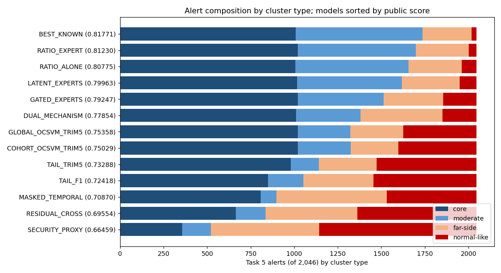
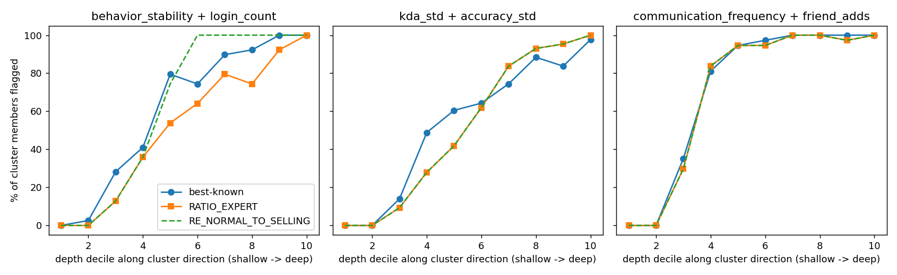

# Task 5 — what the models actually select: cluster analysis (24 November)

Overnight analysis requested on 24 November. No Kaggle submissions were made. Five candidate CSVs were prepared, and the order to test them is at the end.
Scripts: Claude scratchpad `r19_*.py`, not yet in `report.ipynb`.

## 1. Setup

- **Distinct models.** Every saved 2,046-alert Task 5 file was compared, and a file was kept only when its Jaccard similarity with all files already kept was below 0.9. **13 distinct models** remain, all with public scores: BEST_KNOWN 0.81771, RATIO_EXPERT 0.81230, RATIO_ALONE 0.80775, LATENT 0.79963, GATED 0.79247, DUAL 0.77854, GLOBAL_OCSVM_TRIM5 0.75358, COHORT_OCSVM_TRIM5 0.75029, TAIL_TRIM5 0.73288, TAIL_F1 0.72418, MASKED_TEMPORAL 0.70870, RESIDUAL_CROSS 0.69554, SECURITY_PROXY 0.66459.
- **Dropped as near-duplicates:** COHORT_CONDITIONAL (J 0.93 with RATIO_EXPERT), NOFLAG (0.94), OCSVM_F0 (0.93 with GLOBAL), TAIL_OBSERVED_TRIM5 (0.99 with TAIL_TRIM5), and TAIL_TRIM1 (0.92 with TAIL_F1).
- **Candidate pool.** The union of the 13 alert sets: **7,609 players**. These are the players at least one model thought anomalous.
- **Feature space.** Normal scores from average ranks of 29 family levels and 27 Period-4 jumps, plus the 4 security flags (60 columns).
  - The first attempt used a quantile transform. It pushed every tie in zero-inflated counts (`refund_count`, `friend_removes`, `guild_changes`, `device_count`) to about −5, which created artifact clusters. Average ranks put ties at their mid-quantile and remove them.
- **Label-free cluster test.** Every real player and a block-shuffled copy (each family's level and jump permuted together; every global and flag alone) are assigned to the nearest centroid.
  - **real / null** is the ratio of real to null counts in a cluster. A ratio well above 1 means the region is denser than independence allows, i.e. a multi-family mechanism.
  - This test cannot see single-family mechanisms, because the shuffle keeps every marginal. Those are typed with the Round 12 asymmetry rule instead (an anomalous far side).

## 2. How many groups are there?

- **Silhouette is low at every k.** It is 0.18 at k = 2, about 0.09 at k = 3–4, then a flat 0.03–0.04 from k = 5 to 22 that falls further after 22. The first quantile-transform run looked similar: 0.09 up to k = 11, then 0.05.
- **Seed stability** (adjusted Rand index) is ≥ 0.97 for k ≤ 5 and 0.67–0.79 for k = 6–11.
- **HDBSCAN** finds only **2 dense groups**: Module B (166 players) and one giant blob (6,225), with 16% marked as noise. With a minimum cluster size of 200 it finds no dense group at all.
- **Conclusion.** Only about three groups are truly separated:
  - Module B joint jumps;
  - bot regularity;
  - Module A takeover (which merges with purchase + location jumps).

  Everything else is a continuum. Finer k-means clusters are a useful *tessellation* of that continuum for describing what models pick, not natural groups. **k = 20** gave the clearest, reproducible mechanism split, so it is the working map below. Its main results also hold at k = 12, 16, 25 and 30 (Section 5).

## 3. The cluster map (k = 20, seed 42)

**Types:**
- **core:** real/null ≥ 1.5;
- **moderate:** 1.05–1.5;
- **far-side:** the dominant family is an anomalous one-sided tail (|z| ≥ 1);
- **single far-side:** a far-side cluster that the best models barely use;
- **normal-like:** everything else.

Columns BK and RE count best-known and RATIO_EXPERT alerts in each cluster.

| Cluster | Type | Main features | Pool size | Real / null | BK | RE | Weak models (TAIL_F1 / SECURITY_PROXY) |
|---|---|---|---:|---:|---:|---:|---|
| c5 | core | skill_trajectory P4 / skill_trajectory (Module B jump) | 310 | 155.00 | 310 | 308 | 272 / 24 |
| c19 | core | ip_hash_entropy / kda_std (bot regularity, all low) | 209 | 34.83 | 207 | 208 | 208 / 10 |
| c0 | core | currency_transfers P4 / play_pattern_consistency P4 (Module A takeover; 100% password change, 69% mass sale) | 306 | 9.94 | 292 | 304 | 227 / 305 |
| c17 | core | purchase_frequency P4 / location_changes P4 | 208 | 2.00 | 200 | 200 | 143 / 17 |
| c13 | moderate | communication_frequency low / friend_adds high (social) | 371 | 1.25 | 262 | 259 | 79 / 45 |
| c15 | moderate | kda_std / accuracy_std high (erratic) | 429 | 1.13 | 228 | 220 | 57 / 64 |
| c7 | moderate | behavior_stability low / login_count low (account selling: +purchase frequency, older accounts) | 391 | 1.13 | 237 | 200 | 67 / 57 |
| c11 | far-side | activity_level low / skill_rating high (quiet) | 452 | 0.97 | 257 | 258 | 62 / 62 |
| c3 | single far-side | purchase_frequency / purchase_frequency P4 | 391 | 0.97 | 8 | 14 | 58 / 114 |
| c14 | single far-side | location_changes P4 / location_changes | 402 | 0.96 | 4 | 8 | 67 / 126 |
| c10 | single far-side | purchase_amount_mean / purchase_amount_mean P4 | 409 | 0.96 | 5 | 10 | 87 / 97 |
| c2 | single far-side | friend_removes P4 / friend_removes | 437 | 0.95 | 8 | 9 | 75 / 105 |
| c8 | single far-side | currency_transfers P4 / currency_transfers | 405 | 0.93 | 1 | 5 | 54 / 118 |
| c1 | normal-like | communication_frequency P4 / communication_frequency | 405 | 1.00 | 2 | 4 | 96 / 128 |
| c9 | normal-like | skill_trajectory / skill_trajectory P4 | 423 | 0.98 | 2 | 3 | 73 / 125 |
| c4 | normal-like | currency_transfers / login_time_variance P4 | 434 | 0.97 | 3 | 7 | 104 / 144 |
| c16 | normal-like | location_changes / skill_trajectory | 390 | 0.94 | 3 | 6 | 122 / 81 |
| c18 | normal-like | purchase_amount_std P4 / purchase_amount_std | 401 | 0.91 | 6 | 6 | 63 / 130 |
| c12 | normal-like | session_duration_mean / session_duration_mean P4 | 429 | 0.91 | 7 | 11 | 60 / 157 |
| c6 | normal-like | reaction_time_std / reaction_time_std P4 | 407 | 0.88 | 4 | 6 | 72 / 137 |

**Single-family clusters.** Each one is a single family shifted in level, with a P4 jump in the opposite direction. That is a one-family excursion that returns, not a mechanism.

### Proximity and merge tree

- **The core clusters are far from everything** (nearest-centroid distance 5.8–8.0). They merge last, in this order: Module A + purchase/location jump (6.85), then bot regularity (9.33), then Module B (11.09).
- **All 12 single-family clusters sit close together** (nearest distances 2.9–3.3). Ward merges them first into one super-group.
- **The moderate clusters border single-family clusters:**
  - account selling (c7) merges first with `purchase_frequency` high (c3) at 3.36;
  - erratic (c15) joins that pair next;
  - quiet (c11) pairs with `purchase_amount_mean` high (c10) at 3.38;
  - social (c13) joins the big super-group later.

  So the moderate mechanisms have no gap separating them from normal single-family excursions. This is why the final 100–200 slots are hard to fill correctly.
- **Super-groups:**
  1. Module B;
  2. bot regularity;
  3. Module A + purchase/location jump;
  4. one large continuum of moderate mechanisms (account selling, erratic, quiet, social) mixed with single-family excursions.

## 4. What each model does

| Model | core | moderate | far-side (incl. quiet) | normal-like | Score |
|---|---:|---:|---:|---:|---:|
| BEST_KNOWN | 1,009 | 727 | 283 | 27 | 0.81771 |
| RATIO_EXPERT | 1,020 | 679 | 304 | 43 | 0.81230 |
| RATIO_ALONE | 1,007 | 650 | 305 | 84 | 0.80775 |
| LATENT_EXPERTS | 1,017 | 602 | 332 | 95 | 0.79963 |
| GATED_EXPERTS | 1,020 | 494 | 341 | 191 | 0.79247 |
| DUAL_MECHANISM | 1,011 | 370 | 470 | 195 | 0.77854 |
| GLOBAL_OCSVM_TRIM5 | 1,021 | 302 | 303 | 420 | 0.75358 |
| COHORT_OCSVM_TRIM5 | 1,021 | 304 | 272 | 449 | 0.75029 |
| TAIL_TRIM5 | 981 | 161 | 332 | 572 | 0.73288 |
| TAIL_F1 | 850 | 203 | 403 | 590 | 0.72418 |
| MASKED_TEMPORAL | 808 | 90 | 634 | 514 | 0.70870 |
| RESIDUAL_CROSS | 664 | 172 | 527 | 683 | 0.69554 |
| SECURITY_PROXY | 356 | 166 | 622 | 902 | 0.66459 |

- **Every model from GLOBAL_OCSVM up already has the core (about 1,010–1,020 alerts).** Above that level, what separates scores is how the other ~1,030 alerts are split between moderate mechanisms and single-family excursions.
- **Per-model profiles:**
  - Tail-based models spend 570–600 alerts on single-family excursions.
  - SECURITY_PROXY misses Module B and bot regularity almost entirely (24 and 10).
  - MASKED_TEMPORAL and RESIDUAL_CROSS miss bot regularity (18 and 7).
  - DUAL over-fills quiet (308) and social (295).
  - GATED and LATENT gain erratic and account-selling members.
  - RATIO_EXPERT is the closest to best-known.

### Score as a function of cluster types

Least squares over the 13 models (core is the reference):

| Per 100 alerts moved from core into… | Effect on public score |
|---|---|
| moderate | +0.0019 |
| far-side | −0.0079 |
| normal-like | −0.0136 |

- **Fit:** R² 0.996.
- **Robustness:** across k = 12, 16, 20, 25 and 30 with two seeds each, normal-like is always strongly negative (−0.011 to −0.024), far-side is negative (−0.0002 to −0.011), and moderate is ≥ 0 (0 to +0.017). R² is 0.76–0.998.
- **Accuracy:**
  - Leave-one-out error for the top models is +0.0009 (BK), +0.0017 (RE) and −0.0004 (RATIO_ALONE). It is larger lower down (LATENT +0.0039, GATED −0.0061).
  - It predicts the RE→BK gap well (+0.0047 predicted vs +0.0054 actual).
  - **Warning from a file the fit never saw:** COHORT_CONDITIONAL was predicted 0.81530 and scored 0.81143 (+0.0039 error). The model sees only *types*. It cannot judge swaps *inside* a type, which is what that candidate mostly did. Use it only for moves between types, and expect ±0.004–0.006.
- **The leaderboard caveat:** these coefficients come from public scores, so they describe the public split. Every candidate below follows a label-free cluster rule, but the decision to trust this direction is informed by the leaderboard.

### How the score history happened

Ordering the 13 models by score, every step up except one (COHORT→GLOBAL, +0.0033, with no type change) moves alerts **out of single-family clusters** into core or moderate ones. The biggest steps:

| Step | Score change | What moved |
|---|---:|---|
| SECURITY→RESIDUAL | +0.031 | +308 core |
| TAIL_TRIM5→COHORT | +0.017 | +143 moderate |
| GLOBAL→DUAL | +0.025 | social +201 |
| DUAL→GATED | +0.014 | erratic +127 |
| GATED→LATENT | +0.007 | account selling +55, erratic +60 |
| LATENT→RATIO_ALONE | +0.008 | account selling +36 |
| RE→BK | +0.0054 | account selling +37, single-family −37 (approximate) |

### Where each moderate cluster saturates

- **Quiet (c11) and social (c13)** saturate at about 257–262 alerts. The top models agree on that count, and DUAL's 308 / 295 scored lower.
- **Account selling (c7)** is **not saturated**: BK 237 > RE 200 > RATIO_ALONE 197 > LATENT 161 > GATED 106 > DUAL 54, rising with score.
- **Erratic (c15)** is **not saturated** either: BK 228 > RE 220 > LATENT 208 / RATIO_ALONE 201 > GATED 148 > DUAL 21.
- **Single far-side clusters:** the best models take 1–14 from each, while weak models take 50–170.

## 5. RATIO_EXPERT versus best-known

| Cluster type | RE | BK | BK − RE |
|---|---:|---:|---:|
| core | 1,020 | 1,009 | −11 (RE has 12 more Module-A takeover players) |
| moderate | 679 | 727 | **+48** (account selling +37, erratic +8, social +3) |
| far-side (quiet + single) | 304 | 283 | −21 (all in single far-side clusters) |
| normal-like | 43 | 27 | −16 |

### The 224 players the two files disagree on

Clustered on their own (k = 4, silhouette 0.041), they split into:

| Group | Only BK flags | Only RE flags |
|---|---:|---:|
| Account selling (behavior_stability −2.21, purchase_frequency +0.89, account age +0.69, login_count −0.65) | **52** | 13 |
| Erratic (accuracy_std +1.67, kda_std +1.58) | 41 | 42 |
| Single family: purchase_frequency high | 14 | **33** |
| Single family: currency_transfers high with a session-duration drop | 5 | **24** |

The gap between the two files is mostly two things: **RE takes too few account-selling players and too many single-family excursions.**

### Depth inside a cluster explains selection

Depth means a player's projection on the direction from the overall mean to the cluster's centroid.
- **Account selling:** best-known includes more players than RE at every depth (quintiles Q2–Q4: 35 / 77 / 91% vs 24 / 59 / 77%). RE's cutoff along that direction is too strict.
- **Erratic:** best-known takes shallower members (Q2–Q3: 31 / 62% vs 19 / 52%), RE deeper ones (Q4–Q5: 88 / 98% vs 81 / 91%).
- **Social:** the curves are identical.
- **The 44 account-selling players only best-known flags have zero expert support** (none of our experts nominates them), but they are deeper (median 2.91) than unflagged pool members (2.16).

### Where RE's weak alerts come from

RE has 89 alerts in normal-like or single far-side clusters; best-known flags 31% of them.
- Nominated by the ratio population alone: 46 (median ratio rank 1,899, where the local FDR is about 1).
- Nominated by latent directions alone: 19.
- Nominated by far sides alone: 12.
- Support counts: 39 have zero independent supports and 41 have one.

**Model-level reading:** the last ~200 players of the ratio population and the latent-only nominations are where single-family errors come from.

### RE's own core advantage

RE has 12 Module-A takeover players best-known lacks. All 12 have a password change and 82% a mass item sale, at median depth 4.55. They are very likely real; best-known misses them.

## 6. Negative results and caveats

- **Quantile-transform artifact:** tied zero counts become extreme values. Use average-rank normal scores, or restrict to continuous families.
- **The cluster-level null is blind to single-family mechanisms** (quiet scores real/null 0.97). It needs the asymmetry rule alongside.
- **No natural cluster count.** Silhouette and HDBSCAN agree there are only about 3 separated groups. The choice of k = 20 is pragmatic; results were checked at 12–30.
- **Per-cluster values within the moderate group cannot be separated** with 13 models (ridge estimates were unstable). Use cluster *types*, plus saturation evidence.
- **Moves are cluster-level rules**, so no individual row was chosen by hand.

## 7. Candidates prepared (not submitted)

All have 2,046 alerts (Tasks 1–4 are the best-known text, as before) and cards in `src/submission/`. The predicted scores come from the type model: **rough, ±0.004–0.006**.

| # | File | Rule (one line) | Swaps | Shared with BK | Predicted |
|---|---|---|---:|---:|---:|
| 1 | `kaggle_t1234_peer_t5_cluster_normal_to_selling_v1_20261124.csv` | RE minus its 43 alerts in normal-like clusters, plus the 43 deepest account-selling members. **One change; no best-known input.** | 43 | 1,947 | 0.8190 |
| 2 | `kaggle_t1234_peer_t5_cluster_move_c7c15_v1_20261124.csv` | RE minus normal-like and weak single far-side alerts (84), plus the deepest account-selling and erratic members, alternating | 84 | 1,952 | 0.8230 |
| 3 | `kaggle_t1234_peer_t5_cluster_move_re_v1_20261124.csv` | Same removals; refill from all three moderate clusters by depth. Social rises to 274, a saturation risk. | 84 | 1,950 | 0.8230 |
| 4 | `kaggle_t1234_peer_t5_cluster_move_bk_v1_20261124.csv` | **Best-known file** minus its normal-like and weak single far-side alerts, plus RE's core/moderate/quiet alerts it lacks (incl. the 12 Module-A players), then the deepest moderate members | 87 vs RE (48 vs BK) | 1,998 | 0.8229 |
| 5 | `kaggle_t1234_peer_t5_cluster_union_v1_20261124.csv` | Union of RE and BK inside mechanism clusters, intersection inside weak clusters, ranked by votes of the other 11 models | 61 | 1,995 | 0.8199 |

### Suggested order (one change at a time)

1. **#1 NORMAL_TO_SELLING.** The cleanest test of the main insight: single-family excursions out, account selling in. It uses no best-known input. Decide from its result:
   - **> 0.81230:** the type direction holds at the margin. Go to #2.
   - **≤ 0.81230:** the type model fails for small swaps, like COHORT_CONDITIONAL. Stop the manual moves and go to the model-level version below.
2. **#2 MOVE_C7C15.** Doubles the move and adds erratic. Compare it with #1 to see whether the gain scales.
3. **#4 MOVE_BK.** The same rule applied to the best-known file. This is the one most likely to beat 0.81771 for the team, if #1 and #2 work.
4. #5 CLUSTER_UNION or #3 MOVE_RE are only worth testing if a slot is spare. #3 carries the social-saturation risk.

## 8. Next ideas from this analysis

- **Model-level version of the move** (for the notebook, instead of manual moves):
  - cut the ratio population to local FDR < 0.5 (about rank 1,750), and keep latent-only nominations only with a second support;
  - add an account-selling expert with a lower cutoff, e.g. depth along ICA component 18 or the focused comp-18 ratio, sized to the saturation evidence (about 237–245 players in c7).
- **Per-cluster depth cutoffs:** treat each moderate cluster as an expert with its own depth threshold, set where the cluster's real/null excess along depth ends. That would turn the depth curves into a label-free rule.
- **Erratic shape:** best-known prefers shallower erratic members, RE deeper ones. If #2 helps, test an erratic expert using the shallower part of the direction.
- **Keep the core fixed.** About 1,010–1,020 core alerts is common to every good model; no evidence suggests changing it.
